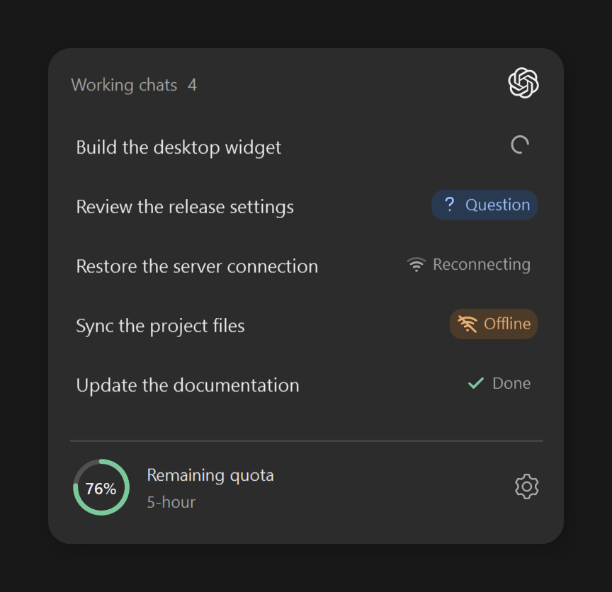
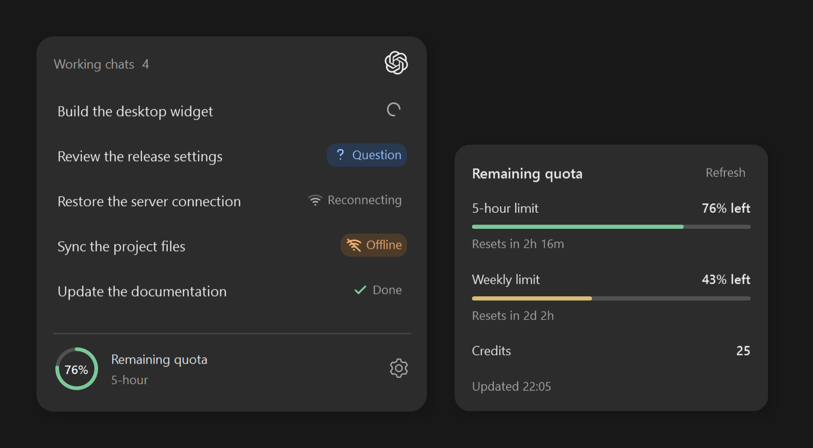
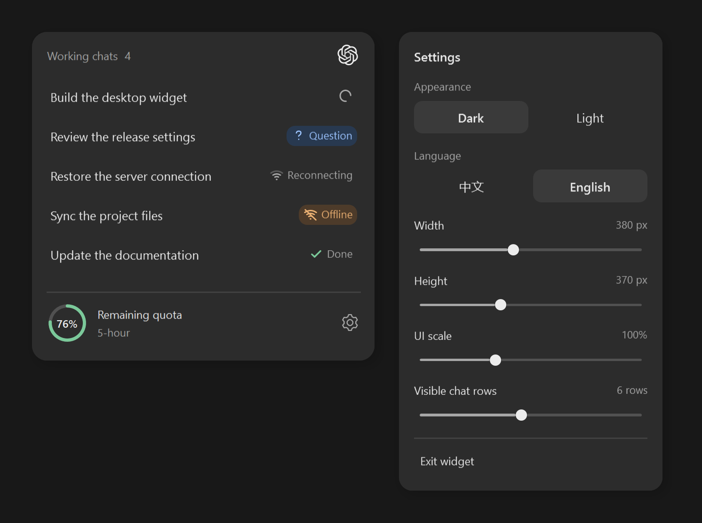
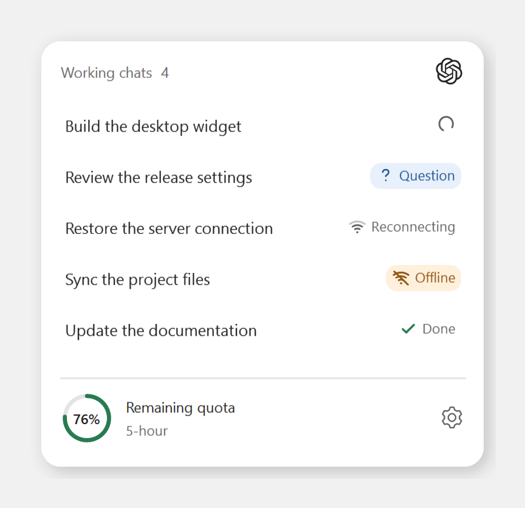
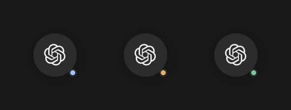

# Codex Float

A small, always-on-top Windows widget for active Codex chats and remaining quota. Keep an eye on several tasks while working in other apps, then click a chat to jump straight back into Codex.

Codex Float installs through Codex's local plugin system and opens a native desktop window. It is an independent companion, not an official OpenAI product or an embedded Codex app panel.



*Native WPF interface rendered with fictional demo chats and sample quota. No private conversations or account details are shown.*

## Features

- Follow working chats, questions, reconnecting, offline, and completion states in one panel.
- Click a row to open its Codex chat. Hover to highlight it and reveal the full title and status.
- Watch a finished task turn into a green check, then fade and slide away.
- View short-term quota first, weekly quota next, reset countdowns, and a nonzero credit balance.
- Drag the panel by its header. Collapse it to a compact ChatGPT icon; click to expand, or hold for about 400 ms before dragging.
- Receive a small blue, orange, or green status dot while collapsed. Offline takes priority over questions, then completion.
- Choose English or Chinese, dark or light, window width and height, UI scale, and visible chat rows. Scroll to reach additional chats.
- Open quota and settings beside the panel. Menus adapt to available screen space and stay outside the conversation area.

## Requirements

- Windows 10 or 11 with .NET Framework 4.8.
- Codex desktop, signed in with a ChatGPT account, and the `codex` CLI with local plugin support.
- Python 3.10 or later on PATH. Both `python` and `pythonw` must be available.

There are no pip or NuGet dependencies. The release and repository include the compiled widget alongside its source.

## Install in Codex

Run these commands in PowerShell:

```powershell
codex plugin marketplace add https://github.com/Liu12345678-Liu/codex-float.git
codex plugin add codex-float@codex-float
```

Start a new Codex session so its plugin hooks load, then ask **"Open Codex Float"**. The SessionStart hook also launches the widget when active. Complete any plugin trust prompt shown by Codex yourself.

### Install from a release ZIP

Download the Windows ZIP from [Releases](https://github.com/Liu12345678-Liu/codex-float/releases), extract it, and open PowerShell in the extracted folder:

```powershell
codex plugin marketplace add .
codex plugin add codex-float@codex-float
```

To open the widget immediately, run:

```powershell
.\plugins\codex-float\bin\CodexFloat.exe
```

Keep `CodexFloat.exe.config` next to the executable and keep the plugin's `ui`, `assets`, and `runtime` folders in place.

## Status and quota

| State | Appearance | Behavior |
| --- | --- | --- |
| Working | Rotating gray circle | A task is active. |
| Question | Blue `? Question` pill | A synchronous input request, approval, or failed request needs attention. Chinese uses `? 问题`. |
| Reconnecting | Wi-Fi bands appear from bottom to top | Codex is performing numbered retries, including 2/5 or 5/5. These attempts stay reconnecting regardless of elapsed time. |
| Offline | Orange Wi-Fi icon with a slash and a pale orange pill | Codex explicitly reports a failed stream connection waiting for network recovery, or ends the turn with a network error. A network wait can happen while the turn is still active. |
| Completed | Animated green check | The row briefly remains, then fades, slides, and closes its space. |

When collapsed, questions show a blue dot, offline chats an orange dot, and completed chats a green dot. Completion remains available until the panel is expanded. Ordinary work does not create a notification dot.

Elapsed retry time alone never marks a chat offline. New numbered retry messages can return a network wait to Reconnecting, and new task activity restores Working. A request hook alone does not prove that the connection has recovered.

The quota orb prefers the shortest available limit, usually five hours. If Codex supplies only a weekly window, the widget shows that window instead. It never invents a missing limit. The details panel lists limits before reset countdowns; an additional balance is labeled **Credits** (中文: **额度**) and appears only when greater than zero. Balances are shown as supplied, without assuming a currency.

The thick quota ring changes color with the amount remaining: green at 50% or more, amber at 20–49%, orange at 10–19%, and red below 10%. Quota refreshes about once a minute; its panel also has a Refresh button.



## Appearance and controls



Width ranges from 280 to 520 logical pixels, height from 220 to 640, and UI scale from 80% to 140%. Visible chat rows range from 1 to 12; additional chats remain in the scrollable list. There is no separate overflow-folding control.

Quota and settings open into available space beside, above, or below the widget. On a small screen they can shrink, scroll, or reposition the widget. If there is still insufficient space, move or reduce the widget and try again.

| Light theme | Collapsed notifications |
| --- | --- |
|  |  |

The icon rotates by 60 degrees around a fixed center during collapse and reverses on expansion. The panel fades and scales with it. Motion follows Windows' animation preference. Text and popup shadows are rendered separately to keep labels sharp.

Use **Settings → Exit widget** to close the window. Launch it again with the command above or the installed `open-float` skill. Your language, theme, size, position, and collapsed state are saved locally.

## Data and compatibility

The widget reads Codex's local conversation catalog, turn history, and retry logs in SQLite read-only mode. If the history index has not recorded a new running turn, a live execution span plus incremental rollout lifecycle metadata can identify it. This fallback follows task start, completion, and interruption and keeps only IDs, states, timestamps, and file offsets in memory. Subagents and chats that are merely opened are excluded. Plugin hooks record only lifecycle state, IDs, and timestamps. Quota uses Codex's official app-server account endpoints. Clicking a chat uses the desktop deep link `codex://threads/<id>`.

Settings and snapshots stay under `%LOCALAPPDATA%\CodexFloat\`. Snapshots include chat titles, IDs, states, and quota summaries. Message bodies, raw error text, passwords, and access tokens are not saved by this project. There is no project telemetry service. See [PRIVACY.md](PRIVACY.md).

Status detection is best effort: Codex's local database schema and log formats are private implementation details, and a standalone app-server does not expose another desktop process's live task state. Unfinished records with no activity for 30 minutes are ignored unless a question is pending. Long quiet work and future Codex schema changes can therefore affect the list. Hook-derived input states require hooks to be enabled in the host. Interrupted tasks are never shown as successful completions.

The current package was checked with Codex CLI `0.166.0-alpha.5.1` on Windows. Mixed-DPI placement and pointer gestures should also be checked manually on the target monitor setup.

## Build and checks

Run the following from a downloaded source checkout:

```powershell
Set-Location .\plugins\codex-float
powershell -NoProfile -ExecutionPolicy Bypass -File .\Build.ps1 -RunChecks
python -m unittest discover -s tests -v
```

The build uses the .NET Framework compiler supplied with Windows. The checks cover quota validation and ordering, read-only access, real SQLite turn transitions, missing-database startup, Windows parent-process liveness, notification priority, translations, WPF startup, and non-overlapping popup geometry.

Documentation images can be regenerated from the plugin directory with `tools\RenderScreenshots.ps1 -OutputDirectory ..\..\docs\screenshots`. It renders the actual WPF controls offscreen with demo data; it does not open a desktop window, control the mouse, or read live chats.

## License and attribution

**Download and use only.** You may download, compile the unmodified source, and use Codex Float. Modification and redistribution are not permitted without written permission. Keep the copyright notice and original repository link. See [LICENSE](LICENSE) for the full custom terms, including rights required by GitHub for public repositories. This is source available, not an open-source license.

The repository is maintained by [Liu12345678-Liu](https://github.com/Liu12345678-Liu). External code contributions are not accepted under the current license; bug reports are welcome in [Issues](https://github.com/Liu12345678-Liu/codex-float/issues).

ChatGPT, Codex, and OpenAI are names or trademarks of OpenAI. The collapse icon comes from Simple Icons; see [third-party notices](plugins/codex-float/assets/NOTICE.md). No affiliation or endorsement is implied.

Technical references: [Codex hooks](https://learn.chatgpt.com/docs/hooks), [app-server](https://learn.chatgpt.com/docs/app-server), [desktop deep links](https://learn.chatgpt.com/docs/reference/commands#deep-links), and [plugin development](https://developers.openai.com/plugins/build/plugins).
